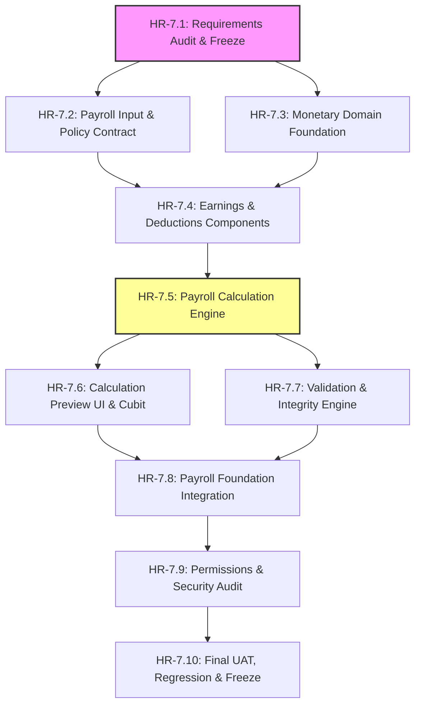

# HR-7.1 — PAYROLL CALCULATION REQUIREMENTS AUDIT & BUSINESS SPECIFICATION
## Enterprise CRM — Payroll Calculation & Validation

**Document Version:** 1.0.0  
**Phase:** HR-7.1 — Payroll Calculation Requirements Audit & Freeze  
**Execution Date:** 2026-09-29  
**Branch:** `feature/hr-7-payroll-calculation`  
**Baseline HEAD Commit:** `bff4973` (`docs(hr): prepare payroll foundation UAT and feature freeze documentation (HR-6.10)`)  
**Status:** `AUDIT COMPLETE — CALCULATION FREEZE BLOCKED BY BUSINESS DECISIONS`  

---

## 1. Purpose and Scope

### 1.1 Objective
The purpose of checkpoint **HR-7.1** is to perform an exhaustive, evidence-based audit of all requirements, domain models, backend contracts, and business rules governing **Payroll Calculation & Validation (HR-7)** in the Enterprise CRM Flutter application.

This checkpoint establishes the authoritative boundary between:
1. **Confirmed Architectural Foundations:** The frozen, read-only domain, repository, and presentation infrastructure established in HR-6.
2. **Proposed Calculation Capabilities:** Architectural proposals for salary modeling, earnings decomposition, deduction tracking, and calculation preview.
3. **Unconfirmed & Backend-Dependent Business Rules:** Formulas, statutory tax policies, attendance proration rules, and accounting lifecycles that lack explicit client-side authorization and must be governed by the authoritative instructor backend.

### 1.2 Non-Implementation Guarantee
In strict adherence to the project development rules, **HR-7.1 introduces zero production calculation engines, zero hardcoded statutory tax formulas, zero speculative salary structures, and zero mutation endpoints**. Financial logic is not implemented until explicit business decisions and test oracles are formally approved.

---

## 2. Git and Repository Baseline

| Parameter | Recorded Value | Verification Source |
|---|---|---|
| **Active Branch** | `feature/hr-7-payroll-calculation` | `git branch --show-current` |
| **Parent Integration Branch** | `feature/hr-6-payroll-foundation` | Local git branch hierarchy |
| **Baseline HEAD Commit** | `bff4973` | `git rev-parse HEAD` |
| **Baseline Commit Message** | `docs(hr): prepare payroll foundation UAT and feature freeze documentation (HR-6.10)` | `git log -1 --oneline` |
| **Working Tree Status** | Clean for HR-6 & HR-7 scope; unrelated HR-5.7 KPI scratch files preserved intact | `git status` |
| **Flutter SDK Version** | Flutter 3.47.5 (channel stable), Dart 3.11.5 | `flutter --version` |
| **Target Platforms** | Android (Mobile/Tablet) + Responsive Web (Desktop/Browser) | `CRM_PRD.md` §1 |

---

## 3. HR-6 Dependency Verification

Phase HR-7 builds directly upon the foundation established in Phase HR-6. An audit of Phase HR-6 was completed with the following verifiable evidence:

| Checkpoint | Scope Description | Verified Commit | Test Suite Status | Acceptance Status |
|---|---|---|---|---|
| **HR-6.1** | Payroll Requirements Audit & Freeze | `947c4f8` | Requirements reviewed | **VERIFIED** |
| **HR-6.2** | Payroll Domain Foundation (`PayrollPeriod`, `PayrollRecord`) | `2623630` | 26 / 26 PASS | **VERIFIED** |
| **HR-6.3** | Payroll Repository & Mock Store (`MockPayrollRepository`) | `e850c24` | 18 / 18 PASS | **VERIFIED** |
| **HR-6.4** | Payroll Period Selection UI (`PayrollPeriodSelector`) | `e0db785` | 27 / 27 PASS | **VERIFIED** |
| **HR-6.5** | Payroll Overview Screen (`PayrollOverviewScreen`) | `a51789d` | 28 / 28 PASS | **VERIFIED** |
| **HR-6.6** | Employee Payroll Details Screen (`PayrollDetailsScreen`) | `f8482f6` | 25 / 25 PASS | **VERIFIED** |
| **HR-6.7** | Employee Payroll History Integration (`EmployeePayrollHistoryScreen`) | `b31d7e3` | 22 / 22 PASS | **VERIFIED** |
| **HR-6.8** | Payroll Permissions & Data Privacy Audit | `d32a94f` | 14 / 14 PASS | **VERIFIED** |
| **HR-6.9** | Responsive UI & State Verification (320px to 1200px) | `9e3ad5c` | 46 / 46 PASS | **VERIFIED** |
| **HR-6.10** | Final Payroll UAT, Full Regression & Feature Freeze | `bff4973` | 7 E2E PASS; 493 HR PASS | **IMPLEMENTED — AWAITING MANUAL UAT** |

### Key HR-6 Architecture Invariants:
1. **Strictly Read-Only:** All existing HR-6 screens and cubits display pre-computed values stored in `PayrollRecord`. Zero mathematical reconciliation (e.g., `net = gross - deductions`) is performed in presentation or domain layers.
2. **Stable Relational Keys:** Relational integrity is enforced using non-empty string IDs (`PayrollRecord.id`, `PayrollRecord.employeeId`, `PayrollRecord.payrollPeriodId`).
3. **Data Model Structure:** `PayrollRecord` stores aggregate numbers (`grossSalary`, `netSalary`, `totalAllowances`, `totalDeductions`) as `double?`. It contains **no itemized breakdown** (no basic pay, HRA, PF, ESI, TDS).
4. **Access Control:** All payroll access is strictly gated by `HrAccessPolicy.canViewPayroll(user)`, which requires `CrmPermissions.payrollView` or `AccountType.admin`. General HR viewing (`hr.view`) grants zero salary visibility.

---

## 4. Sources and Authority

The requirements audit synthesized the following authoritative artifacts:

| Document / Code Source | Location | Authority Level | Core Relevance to HR-7 |
|---|---|---|---|
| **CRM PRD** | `context/CRM_PRD.md` | Authoritative Product Requirements | Explicitly states: *"Detailed payroll calculations and offline mode need confirmation"* (§3) and *"HR/Payroll: ... calculation only as confirmed"* (§4). |
| **CRM TRD** | `context/CRM_TRD.md` | Authoritative Architecture Specification | Mandates feature-first Flutter architecture, BLoC/Cubit state management, and repository pattern. |
| **CRM Backend Schema** | `context/CRM_Backend_Schema.md` | Proposed Integration Contract | Defines general conventions (UTC ISO dates, decimal currency). Does **not** specify payroll calculation formulas or payroll tables. |
| **HR Requirements** | `context/HR_REQUIREMENTS.md` | Phase 1 Foundation Contract | Confirms: *"Compensation: Salary / CTC / Bank details DEFERRED. Strictly excluded from HR-1."* (§4). |
| **HR Payroll Requirements** | `context/HR_PAYROLL_REQUIREMENTS.md` | Phase 6 Requirements Freeze | Formally states: *"Salary calculation formulas, statutory deduction schemes (PF, ESI, TDS), and attendance proration are UNCONFIRMED"* (§7, §15). |
| **Payroll Domain Entities** | `lib/features/hr/domain/entities/` | Active Source Code | Implements immutable `PayrollPeriod` and `PayrollRecord`. Confirms absence of itemized earnings/deductions. |
| **Employee Domain Entity** | `lib/features/hr/domain/entities/employee.dart` | Active Source Code | Explicit docstring: *"Plaintext credentials, passwords, bank details, and sensitive payroll calculations must NEVER be held in this model."* Contains zero salary fields. |
| **Attendance Domain Entity** | `lib/features/hr/domain/entities/attendance_record.dart` | Active Source Code | Explicit docstring: *"Working hours and payroll calculations are strictly excluded."* Zero attendance-to-salary link. |
| **HR Access Policy** | `lib/features/auth/domain/policies/hr_access_policy.dart` | Active Source Code | Authoritative RBAC gate for `payroll.view`. |

---

## 5. Requirements Classification Register

Every candidate requirement for Phase HR-7 has been classified according to strict criteria:
- **CONFIRMED:** Explicitly supported by approved requirements or architectural baseline.
- **PROPOSED:** Architectural mechanism suggested for subsequent subphases, awaiting business approval.
- **UNCONFIRMED:** Mentioned or implied in standard payroll practices but without business contract definition.
- **BACKEND-DEPENDENT:** Belongs to the authoritative backend or requires instructor API contracts.
- **APPROVED DEFERRED:** Explicitly excluded from current phase scope.
- **CONFLICTING:** Competing specifications requiring reconciliation.

| Req ID | Capability / Rule Description | Classification | Authoritative Source | Inputs Required | Dependencies |
|---|---|---|---|---|---|
| **REQ-7.01** | Immutable Domain Entities for Calculation Inputs | **CONFIRMED** | `CRM_TRD.md` §2 | `Employee`, `PayrollPeriod` | HR-6 Baseline |
| **REQ-7.02** | Master Salary Structure Contract (Base, Allowances) | **UNCONFIRMED** | `HR_PAYROLL_REQUIREMENTS.md` §10 | Salary package definitions | Missing Entity / Backend |
| **REQ-7.03** | Earnings Decomposition (Basic, HRA, DA, Special Allowance) | **UNCONFIRMED** | `HR_PAYROLL_REQUIREMENTS.md` §15 | Base compensation allocation % | Business Decision |
| **REQ-7.04** | Statutory PF Deduction (12% of Basic, wage ceiling rules) | **UNCONFIRMED** | `HR_PAYROLL_REQUIREMENTS.md` §7.2 | Basic Salary, statutory rule version | Legal Jurisdiction / Approval |
| **REQ-7.05** | Statutory ESI Deduction (0.75% Employee, wage ceiling rules) | **UNCONFIRMED** | `HR_PAYROLL_REQUIREMENTS.md` §7.2 | Gross Salary, statutory rule version | Legal Jurisdiction / Approval |
| **REQ-7.06** | Income Tax / TDS Withholding (Slab calculation) | **BACKEND-DEPENDENT** | `HR_PAYROLL_REQUIREMENTS.md` §8.1 | Annual tax declarations, regimes | Backend Accounting Engine |
| **REQ-7.07** | Professional Tax (PT) Deduction (State-based slabs) | **UNCONFIRMED** | `HR_PAYROLL_REQUIREMENTS.md` §7.2 | State jurisdiction, gross brackets | Business Decision |
| **REQ-7.08** | Attendance-Based Loss of Pay (LOP) Proration | **UNCONFIRMED** | `HR_PAYROLL_REQUIREMENTS.md` §15.3 | Unpaid absence days, divisor policy | Attendance Integration Policy |
| **REQ-7.09** | Overtime Multipliers (1.5x, 2.0x hourly rates) | **APPROVED DEFERRED** | `HR_PAYROLL_REQUIREMENTS.md` §15.4 | Time-tracking hourly logs | Explicitly Deferred |
| **REQ-7.10** | Mathematical Formulation: Gross = Basic + Allowances | **PROPOSED** | Standard Accounting Convention | Itemized earnings components | REQ-7.02, REQ-7.03 |
| **REQ-7.11** | Mathematical Formulation: Net = Gross - Deductions | **PROPOSED** | Standard Accounting Convention | Total gross, total deductions | REQ-7.10, REQ-7.13 |
| **REQ-7.12** | Client-Side Calculation Preview Service | **PROPOSED** | Architecture Roadmap (HR-7.6) | Validated calculation inputs | Non-authoritative UI preview |
| **REQ-7.13** | Deduction Aggregation: Total Deductions = Sum(Deductions) | **PROPOSED** | Standard Accounting Convention | Validated deduction line items | Deduction Component Model |
| **REQ-7.14** | Authoritative Payroll Run Finalization & Locking | **BACKEND-DEPENDENT** | `HR_PAYROLL_REQUIREMENTS.md` §8.2 | Batch period record processing | Backend Core Engine |
| **REQ-7.15** | Direct Client-Side Repository Mutation of Stored Records | **CONFLICTING** | Prohibited by HR-6 / Proposed HR-7 | Calculated preview output | Violates Read-Only Baseline |
| **REQ-7.16** | Monetary Value Object with Integer Minor Units (Paisa/Cents) | **PROPOSED** | Architecture Roadmap (HR-7.3) | Amount, currency code | Financial Precision Mandate |
| **REQ-7.17** | Disbursement & Bank Transfer Execution | **APPROVED DEFERRED** | `HR_PAYROLL_REQUIREMENTS.md` §8.3 | Bank credentials, payment API | Payment Gateway Out-of-Scope |
| **REQ-7.18** | Payslip PDF Generation & Digital Signing | **APPROVED DEFERRED** | `HR_PAYROLL_REQUIREMENTS.md` §8.4 | Authoritative payroll run data | Document Generation Pipeline |

---

## 6. Calculation Input Contract

### 6.1 Audit of Available Input Sources

An inspection of the active codebase reveals the current status of calculation inputs:

```text
[Employee Repository] ---------> Employee (id, name, department, joiningDate)
                                  └─> ZERO salary / CTC fields present.

[Attendance Repository] -------> AttendanceRecord (employeeId, date, status: Present/Absent)
                                  └─> ZERO hourly logs, working-day policies, or pay multipliers.

[Payroll Repository] ----------> PayrollPeriod (id, name, startDate, endDate)
                                  └─> Date boundaries defined; NO proration rules.

[Master Salary Repository] ----> MISSING / NOT IMPLEMENTED
                                  └─> No entity exists for CTC, Basic Pay, or Allowance rates.
```

### 6.2 The Missing Salary Source Problem
In the current application architecture:
1. `Employee` deliberately excludes salary data to prevent credential/confidentiality leaks (`Employee.dart` line 5).
2. `PayrollRecord` stores historical output figures (`grossSalary`, `netSalary`) for past periods, but does not provide input contract definitions (e.g., an agreed monthly base compensation).
3. **Audit Finding:** The application currently has **no authoritative data source for an employee's contracted salary structure**. 
4. **Resolution Required for HR-7.2:** An input abstraction (`EmployeeSalaryProfile` or `PayrollInputContract`) must be formally specified before calculation logic can execute.

---

## 7. Payroll Period and Effective-Date Requirements

### 7.1 Confirmed Period Invariants
- `PayrollPeriod.id` uniquely identifies the calculation window.
- `startDate` and `endDate` are normalized to UTC midnight (`DateTime.utc(year, month, day)`).
- Boundary invariant: `!startDate.isAfter(endDate)` (enforced in constructor).
- End dates represent inclusive calendar days.

### 7.2 Unresolved Period Business Rules
1. **Calendar Days vs Working Days:** Whether salary is calculated based on total calendar days in the month (e.g., 28, 30, 31) or fixed standard working days (e.g., 26 or 30 days) is **UNCONFIRMED**.
2. **Mid-Period Joining Proration:** If an employee joins on January 15th, is the salary prorated as:
   - $\text{Prorated Pay} = \text{Monthly Pay} \times \frac{\text{Days Active in Period}}{\text{Total Days in Period}}$?
   - Or based on working days? This rule is **UNCONFIRMED**.
3. **Mid-Period Termination / Notice:** Handling of employees leaving mid-period is **UNCONFIRMED**.
4. **Historical Recalculation:** Whether closed periods can be recalculated, or whether recalculations generate adjustment records in subsequent periods, is **BACKEND-DEPENDENT**.

---

## 8. Earnings Component Requirements

| Component | Status | Calculation Basis / Formula | Source Authority | Open Questions |
|---|---|---|---|---|
| **Basic Salary** | **UNCONFIRMED** | Fixed monthly amount or % of CTC (typically 40–50%) | Conventional Practice | Stored fixed number vs derived from CTC? |
| **House Rent Allowance (HRA)** | **UNCONFIRMED** | Typically 40% (non-metro) or 50% (metro) of Basic | Conventional Practice | Metro classification supported? Fixed vs %? |
| **Dearness Allowance (DA)** | **UNCONFIRMED** | Fixed or percentage of Basic | Conventional Practice | Applicable to CRM organization? |
| **Conveyance Allowance** | **UNCONFIRMED** | Fixed flat amount | Conventional Practice | Standardized tier or role-based? |
| **Special / Other Allowance** | **UNCONFIRMED** | Balancing figure (`CTC - Sum(Other Earnings)`) | Conventional Practice | Is special allowance taxable? |
| **Performance Bonus / Incentive** | **APPROVED DEFERRED** | Derived from HR-5 KPI score | `HR_KPI_REQUIREMENTS.md` §15 | Cross-module KPI link strictly deferred. |
| **Reimbursements & Claims** | **APPROVED DEFERRED** | Non-taxable expense additions | `HR_PAYROLL_REQUIREMENTS.md` §15.5 | Expense module not yet built. |

**Audit Conclusion:** No earning component formulas have been approved by the project owner. In HR-7.4, components must be designed as flexible domain entities with explicit stored values rather than hardcoded percentage formulas.

---

## 9. Deduction Component Requirements

| Component | Status | Proposed Computation | Authority / Jurisdiction | Open Questions |
|---|---|---|---|---|
| **Provident Fund (Employee PF)** | **UNCONFIRMED** | 12% of (Basic + DA), capped at statutory wage ceiling | India EPFO (Assumed) | Is Indian EPFO applicable? Is ₹15,000 ceiling enforced? |
| **Employee State Insurance (ESI)** | **UNCONFIRMED** | 0.75% of Gross, applicable if Gross $\le$ ₹21,000/month | India ESIC (Assumed) | Is ESIC applicable? Are overtime wages included? |
| **Tax Deducted at Source (TDS)** | **BACKEND-DEPENDENT** | Annual income tax slab withholding / 12 | Income Tax Act | Old vs New tax regime? Backend must compute. |
| **Professional Tax (PT)** | **UNCONFIRMED** | State slab table (e.g., ₹200/month in Karnataka/Maharashtra) | State Governments | Which state rules apply? Multiple states? |
| **Loss of Pay (LOP / Unpaid Leave)** | **UNCONFIRMED** | Unpaid leave days $\times$ daily salary rate | HR Attendance Integration | What is the daily rate divisor (30 vs 26 vs calendar)? |
| **Salary Advances / Loan Recovery** | **APPROVED DEFERRED** | Fixed monthly installment subtraction | `HR_PAYROLL_REQUIREMENTS.md` §15 | Loan module not implemented. |

**Audit Conclusion:** Statutory rates and deduction policies vary drastically across jurisdictions. Hardcoding Indian statutory rules (PF 12%, ESI 0.75%) into the frontend without explicit approval violates Master Development Rules. Statutory deduction calculation must remain **gated and backend-dependent**.

---

## 10. Approved Formula Register

In accordance with Section 14 of the prompt, the Formula Register audits all explicitly approved mathematical formulas:

| Formula ID | Name | Formula Expression | Order of Execution | Rounding Rule | Status |
|---|---|---|---|---|---|
| **FORM-01** | Total Earnings (Gross) | $\text{Gross} = \sum \text{Earning Components}$ | Step 1 | Round to 2 decimals | **PROPOSED** (Components unapproved) |
| **FORM-02** | Total Deductions | $\text{Deductions} = \sum \text{Deduction Components}$ | Step 2 | Round to 2 decimals | **PROPOSED** (Components unapproved) |
| **FORM-03** | Net Pay Formulation | $\text{Net} = \text{Gross} - \text{Deductions}$ | Step 3 | Round to nearest integer/minor | **PROPOSED** (Accounting Invariant) |
| **FORM-04** | Loss of Pay (LOP) Daily Rate | $\text{Daily Rate} = \frac{\text{Base Pay}}{\text{Divisor Days}}$ | Step 0 | Round to 4 decimals | **UNCONFIRMED** (Divisor undefined) |
| **FORM-05** | Total LOP Deduction | $\text{LOP} = \text{Daily Rate} \times \text{Absent Days}$ | Step 2a | Round to 2 decimals | **UNCONFIRMED** (Attendance policy unlinked) |
| **FORM-06** | Statutory Employee PF | $\text{PF} = \min(\text{Basic}, 15000) \times 0.12$ | Step 2b | Round to nearest integer | **UNCONFIRMED** (Statutory approval missing) |
| **FORM-07** | Statutory Employee ESI | $\text{ESI} = \text{Gross} \times 0.0075 \quad (\text{if Gross} \le 21000)$ | Step 2c | Round to nearest rupee | **UNCONFIRMED** (Statutory approval missing) |

### FORMULA AUDIT GATE:
**ZERO mathematical formulas are currently confirmed or approved by project specifications.**  
All candidate formulas remain in **PROPOSED** or **UNCONFIRMED** status. Consequently, implementation of the calculation engine in HR-7.5 is strictly gated until formulas are formally confirmed.

---

## 11. Monetary Representation and Rounding

### 11.1 Precision Mandate
- **Prohibition of Floating-Point Arithmetic:** Financial calculations must NEVER use raw Dart `double` addition or subtraction due to binary floating-point representation anomalies (e.g., $0.1 + 0.2 = 0.30000000000000004$).
- **Architectural Solution for HR-7.3:** Introduce an immutable `Money` value object storing currency amounts as **64-bit integer minor units (paisa/cents)** with an ISO-4217 currency code:
  $$\text{Minor Units} = \text{Round}(\text{Major Units} \times 10^{\text{Decimal Places}})$$
  For INR/USD: $₹50,000.50 \longrightarrow 5,000,050 \text{ paise}$.

### 11.2 Rounding Standards
- **Component Level Rounding:** Minor components (e.g., LOP, ESI) must specify intermediate rounding behavior.
- **Rounding Strategy:** Banker's rounding (`MidpointRounding.toEven`) or Half-Up (`(x + 0.5).floor()`) is **UNCONFIRMED**.
- **Currency Code:** Default currency is ISO `'INR'`, but multi-currency exchange rate conversions are strictly excluded.
- **Negative Values:** Calculations resulting in negative net pay (e.g., deductions exceed earnings) must be flagged as a validation issue or clawback, rather than silently coerced to zero.

---

## 12. Calculation Output Contract

The calculation service in Phase HR-7 must produce a dedicated, ephemeral preview model:

```text
+-------------------------------------------------------+
|             PayrollCalculationResult                  |
+-------------------------------------------------------+
| - calculationId: String                               |
| - employeeId: String                                  |
| - payrollPeriodId: String                             |
| - calculatedAt: DateTime (UTC)                        |
| - grossEarnings: Money                                |
| - itemizedEarnings: List<EarningLineItem>             |
| - totalDeductions: Money                              |
| - itemizedDeductions: List<DeductionLineItem>         |
| - netPayable: Money                                   |
| - validationIssues: List<CalculationValidationIssue>  |
| - isPreview: bool (true)                              |
| - ruleVersion: String                                 |
+-------------------------------------------------------+
```

### Critical Boundaries:
1. **Preview-Only Nature:** `PayrollCalculationResult` is an in-memory preview. It does NOT overwrite stored `PayrollRecord` entities in `PayrollRepository`.
2. **No False Finalization:** Generating a preview does NOT mark a payroll period as `Processed`, `Closed`, or `Paid`.
3. **No PDF Generation:** The preview produces UI state, not a PDF payslip.

---

## 13. Frontend/Backend Responsibility Boundary

| Responsibility | Frontend (Flutter) | Instructor Backend | Rationale |
|---|---|---|---|
| **Authoritative Payroll Processing** | NO | **YES** | Backend accounting engine is the legal source of truth. |
| **Interactive Calculation Preview** | **YES** (HR-7.6) | Optional | Allows HR admins to simulate compensation prior to batch submission. |
| **Statutory Tax Engine (TDS)** | NO | **YES** | Complex yearly tax regimes belong on server. |
| **Employee Self-Service History** | Read-Only (HR-6.7) | Persisted | Enforces server-side data masking and authorization. |
| **Disbursement / Payment Execution** | NO | **YES** | Banking APIs and payment gateways belong on secure backend. |
| **Payslip PDF Generation & Storage** | NO | **YES** | PDF generation and cloud document storage belong on server. |
| **Calculation Input Validation** | **YES** (HR-7.7) | **YES** | Client validates inputs; server performs authoritative check. |

---

## 14. Authorization and Data Privacy Matrix

| Role / Permission | View Inputs | Run Preview | View Sensitive Breakdown | Export / Print | Modify Policy |
|---|---|---|---|---|---|
| **Administrator (`admin`)** | **YES** | **YES** | **YES** (All Employees) | **YES** | **YES** |
| **Payroll Officer (`payroll.view`)** | **YES** | **YES** | **YES** (All Employees) | **YES** | NO |
| **HR Manager (`hr.view` only)** | NO | NO | NO (Blocked with 403) | NO | NO |
| **Standard User (`user`)** | NO | NO | NO (Blocked with 403) | NO | NO |
| **Self-Service Employee** | DEFERRED | DEFERRED | Own Net Pay Only (Deferred) | DEFERRED | NO |

### Privacy Rules:
- Direct route entry to any calculation preview must be intercepted by `AccessRestrictedScreen` if user lacks `payroll.view` or `admin`.
- Session logout or account switching must immediately invalidate calculation state.
- Calculation error banners must sanitize internal database or formula exceptions.

---

## 15. Validation Requirements

Before computing payroll, the calculation service must validate:
1. **Input Existence:** Non-empty `employeeId` and `payrollPeriodId`.
2. **Active Employment:** Verify `employee.employmentStatus == EmploymentStatus.active`. If terminated or suspended, flag for manual review.
3. **Joining Date Invariant:** If `employee.joiningDate` is after `period.endDate`, calculation is invalid (cannot pay for period prior to hiring).
4. **Missing Compensation Record:** If no base compensation exists for the employee, calculation must FAIL with a clear error, **not silently assume ₹0.00**.
5. **Component Duplication:** Prevent duplicate line items of the same earning/deduction type within a single calculation run.
6. **Negative Earnings Invariant:** Individual earning line items cannot be negative.
7. **Net Pay Deficit:** If $\text{Total Deductions} > \text{Gross Earnings}$, flag a high-severity warning for negative net pay.

---

## 16. Approved Calculation Examples (Test Oracles)

### Status of Worked Examples:
To date, the project specifications provide **zero authoritative worked calculation examples** with expected numeric outputs.

In accordance with Section 20 of the prompt:
> *"A financial calculation cannot be reliably accepted without approved expected results... If worked examples are unavailable, classify the relevant calculation as awaiting test-oracle approval."*

### Proposed Test Fixtures (Awaiting Stakeholder Approval):

#### Candidate Example 1 — Standard Full Month (No LOP, Standard Deductions)
- **Employee:** `emp_1` (Senior Developer, joined 2024-01-01)
- **Period:** `period_2026_01` (2026-01-01 to 2026-01-31, 31 calendar days)
- **Proposed Base Pay:** ₹50,000.00
- **Proposed HRA (50%):** ₹25,000.00
- **Proposed Gross:** ₹75,000.00
- **Proposed PF (12% of 15k cap):** ₹1,800.00
- **Proposed Professional Tax:** ₹200.00
- **Proposed Net Pay:** ₹73,000.00
- **Approval Status:** **AWAITING STAKEHOLDER APPROVAL**

#### Candidate Example 2 — Mid-Period Joiner (Prorated)
- **Employee:** `emp_4` (Joined 2026-01-16, active 16 out of 31 days)
- **Proposed Base Pay:** ₹62,000.00 monthly
- **Proposed Prorated Gross:** ₹32,000.00 ($62,000 \times \frac{16}{31}$)
- **Approval Status:** **AWAITING STAKEHOLDER APPROVAL**

---

## 17. Historical Data and Rule Versioning

1. **Retroactive Rule Changes:** If statutory PF or tax rates change on April 1st, calculations for January must utilize the historical rule version active during that period.
2. **Rule Version Identifier:** Every calculation preview must capture a `ruleVersion` metadata tag (e.g., `'RULES-2026.1'`).
3. **Immutability of Finalized Runs:** Calculations must never overwrite previously finalized historical payroll runs stored in the backend.

---

## 18. Conflicts and Open Questions

The following business decisions remain unapproved and block completion of the calculation freeze:

| Issue ID | Open Question | Impact on Implementation | Resolution Needed From |
|---|---|---|---|
| **ISSUE-01** | Where is an employee's base salary stored? | Blocks input retrieval for calculation engine (HR-7.2). | Project Owner / Instructor |
| **ISSUE-02** | What jurisdiction's statutory deductions apply? | Blocks PF, ESI, and Professional Tax formulas (HR-7.4). | Project Owner / Instructor |
| **ISSUE-03** | What is the exact formula for Loss of Pay (LOP)? | Blocks attendance-to-payroll integration (HR-7.4). | Project Owner / Instructor |
| **ISSUE-04** | Is client-side calculation strictly a preview, or does it write to repository? | Determines repository mutation contracts in HR-7.8. | Architecture Authority |
| **ISSUE-05** | What rounding method is required (Half-up vs Half-even)? | Blocks precision testing in HR-7.3 and HR-7.5. | Finance / Stakeholder |

---

## 19. HR-7.2 Through HR-7.10 Dependency Map



### Readiness Assessment by Subphase:
- **HR-7.2 (Input & Policy Contract):** **READY (SAFE).** Can define abstract input interfaces, contracts, and salary profile entities without hardcoding calculations.
- **HR-7.3 (Monetary Domain Foundation):** **READY (SAFE).** Can implement integer-minor-unit `Money` value object, currency formatting, and overflow-safe arithmetic.
- **HR-7.4 (Earnings & Deductions):** **PARTIAL.** Can model extensible component structures, but statutory formulas remain blocked.
- **HR-7.5 (Calculation Engine):** **BLOCKED.** Gated until FORM-01 through FORM-07 and worked examples are approved.
- **HR-7.6 through HR-7.10:** **DOWNSTREAM DEPENDENT.** Gated upon resolution of HR-7.5.

---

## 20. Explicitly Excluded Scope

The following capabilities are explicitly confirmed as **OUT OF SCOPE** for Phase HR-7:
1. **Tax Filing & Statutory Submissions:** E-filing with government tax authorities (PF portal, ESIC portal, TRACES).
2. **Direct Bank Disbursement:** Bank payment gateways, NEFT/RTGS NACH file generation, or UPI execution.
3. **Payslip Document Generation:** PDF rendering, document watermarking, and digital signature attachment.
4. **Employee Loans & Advances:** Loan amortization schedules and recovery management.
5. **Expense Reimbursement Workflow:** Travel bills upload and receipt verification.
6. **Live Multi-Currency FX Engine:** Automated foreign exchange rate conversion.

---

## 21. Mandatory Decision Register

| Decision Area | Confirmed? | Evidence / Source Document | Impact if Unresolved |
|---|---|---|---|
| **Payroll Input Ownership** | **UNCONFIRMED** | `Employee.dart` line 5 excludes salary; no salary store exists. | HR-7.2 cannot resolve base pay. |
| **Supported Currency** | **PROPOSED** | `PayrollRecord.currency` stores `'INR'` in mock seeds. | Multi-currency vs single currency in HR-7.3. |
| **Monetary Precision** | **PROPOSED** | Integer minor units (paisa) proposed to eliminate float drift. | Decimal arithmetic precision in HR-7.3. |
| **Rounding Algorithm** | **UNCONFIRMED** | No rounding rule in PRD or TRD. | 1-paisa rounding divergence in HR-7.5. |
| **Earnings Rules** | **UNCONFIRMED** | `HR_PAYROLL_REQUIREMENTS.md` §15 lists earnings as deferred. | Cannot calculate gross salary in HR-7.4. |
| **Deduction Rules** | **UNCONFIRMED** | `HR_PAYROLL_REQUIREMENTS.md` §7.2 lists PF/ESI/TDS as unconfirmed. | Cannot calculate deductions in HR-7.4. |
| **Formula Definitions** | **UNCONFIRMED** | `HR_PAYROLL_REQUIREMENTS.md` §7.1 lists formulas as unconfirmed. | Calculation engine blocked in HR-7.5. |
| **Expected Test Results** | **UNCONFIRMED** | Zero worked examples exist in project specifications. | Test oracle missing for HR-7.5/7.10. |
| **Preview Authority** | **PROPOSED** | Ephemeral client-side preview model proposed. | Prevents overwriting authoritative HR-6 data. |
| **Financial-Data Access** | **CONFIRMED** | `HrAccessPolicy.canViewPayroll` requires `payroll.view` or `admin`. | Security rules enforced in HR-7.9. |
| **Backend Responsibility**| **CONFIRMED** | `CRM_PRD.md` §3 & `HR_PAYROLL_REQUIREMENTS.md` §8. | Flutter client does not replace backend engine. |

---

## 22. HR-7.1 Exit Criteria & Completion Gate

- [x] Starting Git state recorded on dedicated feature branch (`feature/hr-7-payroll-calculation`).
- [x] Phase HR-6 baseline implementation and acceptance status audited and verified.
- [x] Authoritative project documents and active source code reviewed.
- [x] Absence of base salary in `Employee` entity confirmed and documented.
- [x] Classification register completed (Confirmed, Proposed, Unconfirmed, Backend-Dependent, Deferred).
- [x] Period and effective-date requirements audited.
- [x] Candidate earnings and deduction components audited.
- [x] Approved Formula Register compiled (zero approved formulas confirmed).
- [x] Monetary precision and float-avoidance mandate documented.
- [x] Calculation output and ephemeral preview model defined.
- [x] Frontend vs backend responsibility boundaries established.
- [x] Authorization and data privacy rules reviewed.
- [x] Input validation rules specified.
- [x] Missing worked calculation test oracles identified.
- [x] Downstream subphase dependency map produced (HR-7.2 & HR-7.3 safe; HR-7.5 gated).
- [x] Mandatory decision register completed.
- [x] Full document reviewed for unsupported assumptions.
- [x] Dedicated Git commit created and verified.

---

## 23. Final Requirements Freeze Status

**FINAL STATUS:**  
`AUDIT COMPLETE — CALCULATION FREEZE BLOCKED BY BUSINESS DECISIONS`

### Justification:
The requirements audit is 100% complete and verified against the actual repository source code. However, because essential financial business rules (employee base salary structure, statutory deduction schemes, attendance proration divisors, and approved calculation formulas) have not been formally confirmed by the project owner or instructor backend contract, the calculation engine itself **cannot be frozen**. 

Subphases **HR-7.2 (Input & Policy Contract)** and **HR-7.3 (Monetary Domain Foundation)** may safely proceed to establish clean, unopinionated domain abstractions and precision value objects. Subphase **HR-7.5 (Calculation Engine)** must remain gated until formal formula approval and known-answer test fixtures are provided.
