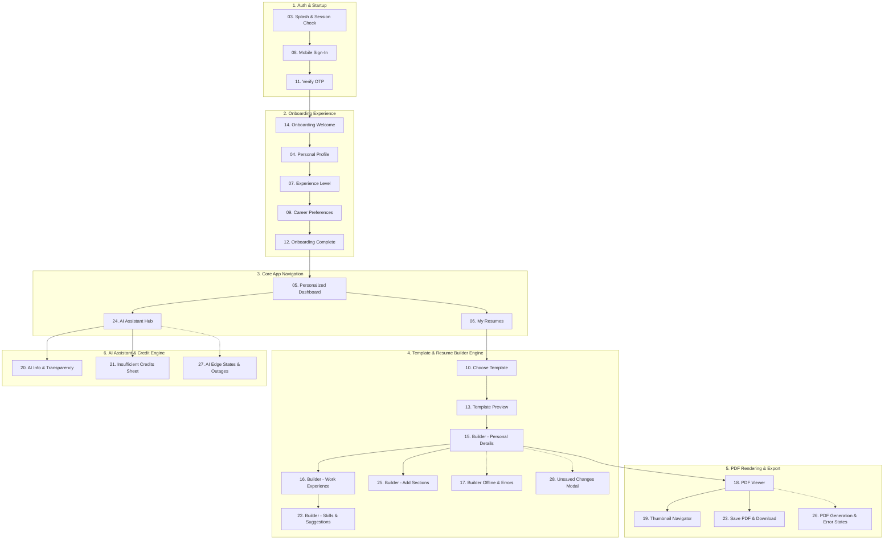

# PrepMate AI — UI Screens Context & Architecture Specification

**Project Title:** PrepMate AI Splash Screen  
**Stitch Project ID:** `2059051755654798838`  
**Total Screens Captured:** 28 Complete Screens (Auth, Onboarding, Dashboard, Resume Builder, Templates, PDF Viewer, AI Assistant)  
**Design System:** Material 3 Adaptive (Plus Jakarta Sans, Primary `#2457D6`, Teal Accent `#006A65`)  
**Context Location:** `c:\Users\vkcha\Desktop\Assets\project\enterprise_crm\context\prepmate_ai\`  

---

## 1. Overview & Directory Index

All screenshot images and complete standalone source code (Tailwind HTML & SVG) have been extracted, downloaded, and cataloged locally for offline access, screen building, and design reference.

```
context/prepmate_ai/
├── DESIGN_SYSTEM.md                    # Full M3 color palette, typography scale, spacing & shapes
├── screens_metadata.json               # Raw JSON index with original Stitch endpoints (28 screens)
├── screens_extracted_elements.json     # Extracted UI elements, buttons, headings, and icons (28 screens)
├── images/                             # High-resolution mobile screenshots & vector PNGs (01 to 28)
└── code/                               # HTML / SVG implementations with Tailwind & M3 CSS (01 to 28)
```

---

## 2. Complete 28-Screen Inventory Table

| # | Stitch Screen ID | Screen Title | Flow Module | Dimensions | Local Image | Local Code |
|---|---|---|---|---|---|---|
| **01** | `d8499ec655cf49208f47f0e812d4c25f` | Onboarding Career Progress Illustration | Brand Graphic | SVG Vector | [Image](file:///c:/Users/vkcha/Desktop/Assets/project/enterprise_crm/context/prepmate_ai/images/01_onboarding_career_progress_illustration.png) | [Code](file:///c:/Users/vkcha/Desktop/Assets/project/enterprise_crm/context/prepmate_ai/code/01_onboarding_career_progress_illustration.html) |
| **02** | `ff1694eb317c462bb786b073d06ff633` | PrepMate AI Logo | Brand Identity | SVG Vector | [Image](file:///c:/Users/vkcha/Desktop/Assets/project/enterprise_crm/context/prepmate_ai/images/02_prepmate_ai_logo.png) | [Code](file:///c:/Users/vkcha/Desktop/Assets/project/enterprise_crm/context/prepmate_ai/code/02_prepmate_ai_logo.html) |
| **03** | `6e44316075dd4f5d9f310dd45ea57f71` | Splash & Session Check | Auth / Startup | 780 x 1768 | [Image](file:///c:/Users/vkcha/Desktop/Assets/project/enterprise_crm/context/prepmate_ai/images/03_splash_session_check.png) | [Code](file:///c:/Users/vkcha/Desktop/Assets/project/enterprise_crm/context/prepmate_ai/code/03_splash_session_check.html) |
| **04** | `17cc0e40b80c4748ac48471a9a9e025d` | Set up your profile | Onboarding (Step 2) | 780 x 2114 | [Image](file:///c:/Users/vkcha/Desktop/Assets/project/enterprise_crm/context/prepmate_ai/images/04_set_up_your_profile.png) | [Code](file:///c:/Users/vkcha/Desktop/Assets/project/enterprise_crm/context/prepmate_ai/code/04_set_up_your_profile.html) |
| **05** | `93f24168575545c3942bd7b5a84090a1` | Personalized Home Dashboard | Core / Dashboard | 780 x 3510 | [Image](file:///c:/Users/vkcha/Desktop/Assets/project/enterprise_crm/context/prepmate_ai/images/05_personalized_home_dashboard.png) | [Code](file:///c:/Users/vkcha/Desktop/Assets/project/enterprise_crm/context/prepmate_ai/code/05_personalized_home_dashboard.html) |
| **06** | `b351b6c84b07497d8d3ae5c2fc452a6b` | My Resumes | Core / Resumes | 780 x 1970 | [Image](file:///c:/Users/vkcha/Desktop/Assets/project/enterprise_crm/context/prepmate_ai/images/06_my_resumes.png) | [Code](file:///c:/Users/vkcha/Desktop/Assets/project/enterprise_crm/context/prepmate_ai/code/06_my_resumes.html) |
| **07** | `3cc77a7486b742709b7da60621d22e07` | Experience level | Onboarding (Step 3) | 780 x 2218 | [Image](file:///c:/Users/vkcha/Desktop/Assets/project/enterprise_crm/context/prepmate_ai/images/07_experience_level.png) | [Code](file:///c:/Users/vkcha/Desktop/Assets/project/enterprise_crm/context/prepmate_ai/code/07_experience_level.html) |
| **08** | `3767172c537c43c49197cad1c4bd216e` | Mobile Sign-In | Auth / Login | 780 x 1640 | [Image](file:///c:/Users/vkcha/Desktop/Assets/project/enterprise_crm/context/prepmate_ai/images/08_mobile_sign_in.png) | [Code](file:///c:/Users/vkcha/Desktop/Assets/project/enterprise_crm/context/prepmate_ai/code/08_mobile_sign_in.html) |
| **09** | `08f51956683e4ad1b9864dbaeb4018f7` | Career Preferences & Goals | Onboarding (Step 4) | 780 x 3256 | [Image](file:///c:/Users/vkcha/Desktop/Assets/project/enterprise_crm/context/prepmate_ai/images/09_career_preferences_goals.png) | [Code](file:///c:/Users/vkcha/Desktop/Assets/project/enterprise_crm/context/prepmate_ai/code/09_career_preferences_goals.html) |
| **10** | `fe186b305246412e93ce31e74c1211fa` | Choose a Template | Resume Templates | 780 x 3426 | [Image](file:///c:/Users/vkcha/Desktop/Assets/project/enterprise_crm/context/prepmate_ai/images/10_choose_a_template.png) | [Code](file:///c:/Users/vkcha/Desktop/Assets/project/enterprise_crm/context/prepmate_ai/code/10_choose_a_template.html) |
| **11** | `2b2812e12781446998f16673e1930b7f` | Verify mobile number | Auth / OTP | 780 x 1532 | [Image](file:///c:/Users/vkcha/Desktop/Assets/project/enterprise_crm/context/prepmate_ai/images/11_verify_mobile_number.png) | [Code](file:///c:/Users/vkcha/Desktop/Assets/project/enterprise_crm/context/prepmate_ai/code/11_verify_mobile_number.html) |
| **12** | `7f683a6139924ea4be728a500ae2a182` | Onboarding Complete | Onboarding Finish | 780 x 2052 | [Image](file:///c:/Users/vkcha/Desktop/Assets/project/enterprise_crm/context/prepmate_ai/images/12_onboarding_complete.png) | [Code](file:///c:/Users/vkcha/Desktop/Assets/project/enterprise_crm/context/prepmate_ai/code/12_onboarding_complete.html) |
| **13** | `8167e1be7ee04953b713ca3e4bb49b65` | Template Preview | Resume Preview | 780 x 3182 | [Image](file:///c:/Users/vkcha/Desktop/Assets/project/enterprise_crm/context/prepmate_ai/images/13_template_preview.png) | [Code](file:///c:/Users/vkcha/Desktop/Assets/project/enterprise_crm/context/prepmate_ai/code/13_template_preview.html) |
| **14** | `5e36514bff514e23b9c178a93cc9eabb` | Onboarding Welcome | Onboarding (Step 1) | 780 x 2240 | [Image](file:///c:/Users/vkcha/Desktop/Assets/project/enterprise_crm/context/prepmate_ai/images/14_onboarding_welcome.png) | [Code](file:///c:/Users/vkcha/Desktop/Assets/project/enterprise_crm/context/prepmate_ai/code/14_onboarding_welcome.html) |
| **15** | `186161eef9da4663be51094ff9a9a0a8` | Resume Builder — Personal Details | Resume Builder | 780 x 3096 | [Image](file:///c:/Users/vkcha/Desktop/Assets/project/enterprise_crm/context/prepmate_ai/images/15_resume_builder_personal_details.png) | [Code](file:///c:/Users/vkcha/Desktop/Assets/project/enterprise_crm/context/prepmate_ai/code/15_resume_builder_personal_details.html) |
| **16** | `4ebc89b195494ab3960ac679bceb7ecf` | Resume Builder — Work Experience | Resume Builder | 780 x 2800 | [Image](file:///c:/Users/vkcha/Desktop/Assets/project/enterprise_crm/context/prepmate_ai/images/16_resume_builder_work_experience.png) | [Code](file:///c:/Users/vkcha/Desktop/Assets/project/enterprise_crm/context/prepmate_ai/code/16_resume_builder_work_experience.html) |
| **17** | `926d18f8f4fe4109af8ed9db77792919` | Resume Builder — Errors & Offline State | Builder Edge State | 780 x 2740 | [Image](file:///c:/Users/vkcha/Desktop/Assets/project/enterprise_crm/context/prepmate_ai/images/17_resume_builder_errors_offline_state.png) | [Code](file:///c:/Users/vkcha/Desktop/Assets/project/enterprise_crm/context/prepmate_ai/code/17_resume_builder_errors_offline_state.html) |
| **18** | `39fe87786f744cd6b8da61b84586a071` | PDF Preview — Document Viewer | PDF Engine | 780 x 2516 | [Image](file:///c:/Users/vkcha/Desktop/Assets/project/enterprise_crm/context/prepmate_ai/images/18_pdf_preview_document_viewer.png) | [Code](file:///c:/Users/vkcha/Desktop/Assets/project/enterprise_crm/context/prepmate_ai/code/18_pdf_preview_document_viewer.html) |
| **19** | `ffe163f461644b029149093b9e47ddb1` | PDF Preview — Thumbnail Navigator & Info | PDF Engine | 780 x 1768 | [Image](file:///c:/Users/vkcha/Desktop/Assets/project/enterprise_crm/context/prepmate_ai/images/19_pdf_preview_thumbnail_navigator_info.png) | [Code](file:///c:/Users/vkcha/Desktop/Assets/project/enterprise_crm/context/prepmate_ai/code/19_pdf_preview_thumbnail_navigator_info.html) |
| **20** | `8b0a2c71603a46dcb169c956e0a285bf` | AI Assistant — Info & Transparency Sheet | AI Assistant | 780 x 1768 | [Image](file:///c:/Users/vkcha/Desktop/Assets/project/enterprise_crm/context/prepmate_ai/images/20_ai_assistant_info_transparency_sheet.png) | [Code](file:///c:/Users/vkcha/Desktop/Assets/project/enterprise_crm/context/prepmate_ai/code/20_ai_assistant_info_transparency_sheet.html) |
| **21** | `3885b833eca94c359b0f98043c8a8f5c` | AI Assistant — Insufficient Credits Sheet | AI Credits | 780 x 1768 | [Image](file:///c:/Users/vkcha/Desktop/Assets/project/enterprise_crm/context/prepmate_ai/images/21_ai_assistant_insufficient_credits_sheet.png) | [Code](file:///c:/Users/vkcha/Desktop/Assets/project/enterprise_crm/context/prepmate_ai/code/21_ai_assistant_insufficient_credits_sheet.html) |
| **22** | `96cbdd79db5d4a61ac45050ffa3cdabf` | Resume Builder — Skills & Suggestions | Resume Builder | 780 x 2384 | [Image](file:///c:/Users/vkcha/Desktop/Assets/project/enterprise_crm/context/prepmate_ai/images/22_resume_builder_skills_suggestions.png) | [Code](file:///c:/Users/vkcha/Desktop/Assets/project/enterprise_crm/context/prepmate_ai/code/22_resume_builder_skills_suggestions.html) |
| **23** | `73fd0c5a6b714869afaa6572a8a2cc79` | PDF Preview — Save PDF & Download | PDF Engine | 780 x 1768 | [Image](file:///c:/Users/vkcha/Desktop/Assets/project/enterprise_crm/context/prepmate_ai/images/23_pdf_preview_save_pdf_download.png) | [Code](file:///c:/Users/vkcha/Desktop/Assets/project/enterprise_crm/context/prepmate_ai/code/23_pdf_preview_save_pdf_download.html) |
| **24** | `7c3cac5d2c17465f89cc2322bb2735de` | AI Assistant — Hub | AI Assistant | 780 x 4136 | [Image](file:///c:/Users/vkcha/Desktop/Assets/project/enterprise_crm/context/prepmate_ai/images/24_ai_assistant_hub.png) | [Code](file:///c:/Users/vkcha/Desktop/Assets/project/enterprise_crm/context/prepmate_ai/code/24_ai_assistant_hub.html) |
| **25** | `071206a7d3034f6d9750ef89121f074b` | Resume Builder — Add More Sections | Resume Builder | 780 x 1768 | [Image](file:///c:/Users/vkcha/Desktop/Assets/project/enterprise_crm/context/prepmate_ai/images/25_resume_builder_add_more_sections.png) | [Code](file:///c:/Users/vkcha/Desktop/Assets/project/enterprise_crm/context/prepmate_ai/code/25_resume_builder_add_more_sections.html) |
| **26** | `c401a3c51c1a486aa1dd129bbf324a81` | PDF Preview — Generation & Error States | PDF Edge State | 780 x 1820 | [Image](file:///c:/Users/vkcha/Desktop/Assets/project/enterprise_crm/context/prepmate_ai/images/26_pdf_preview_generation_error_states.png) | [Code](file:///c:/Users/vkcha/Desktop/Assets/project/enterprise_crm/context/prepmate_ai/code/26_pdf_preview_generation_error_states.html) |
| **27** | `4616427a010647d5bac7225b2a54fc1a` | AI Assistant — Edge States & Outage Handling | AI Edge State | 780 x 3416 | [Image](file:///c:/Users/vkcha/Desktop/Assets/project/enterprise_crm/context/prepmate_ai/images/27_ai_assistant_edge_states_outage_handling.png) | [Code](file:///c:/Users/vkcha/Desktop/Assets/project/enterprise_crm/context/prepmate_ai/code/27_ai_assistant_edge_states_outage_handling.html) |
| **28** | `99577e8f0df241d3af9e0aacc8bd28d0` | Resume Builder — Unsaved Changes Modal | Builder Dialog | 780 x 1768 | [Image](file:///c:/Users/vkcha/Desktop/Assets/project/enterprise_crm/context/prepmate_ai/images/28_resume_builder_unsaved_changes_modal.png) | [Code](file:///c:/Users/vkcha/Desktop/Assets/project/enterprise_crm/context/prepmate_ai/code/28_resume_builder_unsaved_changes_modal.html) |

---

## 3. Application Architecture by Module



---

## 4. Deep-Dive Specification for New Screens (15 to 28)

### Screen 15: Resume Builder — Personal Details
- **Stitch ID:** `186161eef9da4663be51094ff9a9a0a8`
- **Role:** Primary step of the active resume editor.
- **Visual Structure:**
  - Section step tab bar: `Personal details` (active), `Summary`, `Experience`, `Education`, `Skills`.
  - Recruiter Best Practice Callout banner (`bolt` icon): *"Include city/state, professional email, and LinkedIn URL for maximum recruiter visibility"*.
  - Comprehensive form fields with floating M3 labels:
    - Full Name (`e.g. Vikash Sharma`)
    - Professional Title (`e.g. Senior Mobile Architect`)
    - Email address (`name@domain.com`)
    - Phone number with country badge (`+91 98765 43210`)
    - Location (`e.g. San Francisco, USA`)
    - LinkedIn Profile (`linkedin.com/in/username`)
    - GitHub / Portfolio (`github.com/username or portfolio.dev`)
    - Personal Website (`https://yourprofile.com`)
  - Sticky bottom action bar with *"Preview"* and *"Save & Continue"* (`arrow_forward`).

---

### Screen 16: Resume Builder — Work Experience
- **Stitch ID:** `4ebc89b195494ab3960ac679bceb7ecf`
- **Role:** Interactive work experience timeline editor with drag-and-drop ordering.
- **Visual Structure:**
  - Step navigation tabs with completed checks.
  - Job experience timeline cards:
    - Role title, company name, employment dates, location, and bullet point editor.
    - Drag handle icon (`drag_indicator`) for reordering positions.
    - Contextual AI bullet generator button (`auto_awesome` *"Enhance bullets with AI"*).
  - Career changer callout: *"Fresher or career changer? Highlight transferable academic or freelance projects"*.
  - Add Position button (`add` *"Add another work experience"*).

---

### Screen 17: Resume Builder — Errors & Offline State
- **Stitch ID:** `926d18f8f4fe4109af8ed9db77792919`
- **Role:** Validation error handling and offline synchronization recovery.
- **Visual Structure:**
  - Offline sync alert banner (`cloud_off`): *"Working offline. Changes are saved locally on your device. We'll sync once reconnected."* with manual `sync` *"Retry"* button.
  - Field-level validation error highlights (Red 1.5dp border `#BA1A1A` with red helper text).
  - Step badge counter showing `3 errors in Personal Details`.
  - Floating draft status pill (`cloud_done` *"Saved locally 2m ago"*).

---

### Screen 18: PDF Preview — Document Viewer
- **Stitch ID:** `39fe87786f744cd6b8da61b84586a071`
- **Role:** Realistic paper-canvas PDF document preview with zoom and pan controls.
- **Visual Structure:**
  - Floating canvas elevation simulating physical letter/A4 paper resting on `#F9F9FF` background.
  - Full document typography render with high-fidelity margins and ATS-compliant hierarchy.
  - Floating zoom controls: `+` Zoom In, `-` Zoom Out, `fit_screen` Reset zoom, `tune` Adjust margins.
  - Floating Bottom Action Bar:
    - Primary: `download` *"Download PDF"* (`#2457D6`).
    - Secondary: `edit` *"Edit"* to return to builder.

---

### Screen 19: PDF Preview — Thumbnail Navigator & Info
- **Stitch ID:** `ffe163f461644b029149093b9e47ddb1`
- **Role:** Multi-page thumbnail drawer and metadata inspector for PDF documents.
- **Visual Structure:**
  - Bottom sheet modal displaying all pages as miniature interactive thumbnails.
  - Page indicator: `Page 1 of 2` with active blue boundary.
  - Jump-to-page quick link (`launch` *"Jump to Page 1"*).
  - Document Info tab (`info`): Page count, estimated ATS parse time, font readability score.

---

### Screen 20: AI Assistant — Info & Transparency Sheet
- **Stitch ID:** `8b0a2c71603a46dcb169c956e0a285bf`
- **Role:** User trust, AI privacy policy, and algorithmic transparency modal.
- **Visual Structure:**
  - Bottom sheet with shield icon (`shield` / `verified_user`).
  - Title: *"About AI tools in PrepMate"*.
  - 3 Privacy pillars:
    1. **Data Confidentiality:** Resumes are never used to train public foundational models.
    2. **Review & User Control:** You always retain complete control to accept or reject AI edits.
    3. **No Guaranteed Outcomes:** AI enhances phrasing but does not promise recruiter hiring.
  - Action button: *"Got it, thanks"* (`check` icon).

---

### Screen 21: AI Assistant — Insufficient Credits Sheet
- **Stitch ID:** `3885b833eca94c359b0f98043c8a8f5c`
- **Role:** Credit paywall, low token warning, and top-up sheet.
- **Visual Structure:**
  - Warning alert badge (`toll` / `warning` `#A15C00`).
  - Headline: *"You need more AI credits"*.
  - Explanatory copy: *"This operation requires 5 credits, but you currently have 1 credit remaining."*
  - Refill plans preview (Starter pack, Pro pack, Unlimited subscription).
  - Primary CTA: `bolt` *"View credit options"* with secondary *"Not now"*.

---

### Screen 22: Resume Builder — Skills & Suggestions
- **Stitch ID:** `96cbdd79db5d4a61ac45050ffa3cdabf`
- **Role:** Categorized skill tagging with AI job-match suggestions.
- **Visual Structure:**
  - Search input: *"Type a skill (e.g. Flutter, Kotlin, Docker)..."*.
  - Categorized skill chip groups:
    - *Programming Languages* (`Dart`, `Kotlin`, `Swift`, `TypeScript`).
    - *Technical & Frameworks* (`Flutter`, `Bloc`, `Provider`, `REST APIs`, `CI/CD`).
  - Recommended AI Chips: *"Recommended for Flutter & Mobile roles"* with single-tap `+ Add` pills.

---

### Screen 23: PDF Preview — Save PDF & Download
- **Stitch ID:** `73fd0c5a6b714869afaa6572a8a2cc79`
- **Role:** Device file export, filename configuration, and directory picker sheet.
- **Visual Structure:**
  - File card: `Vikash_Sharma_Resume_2026.pdf` (`245 KB`).
  - Destination directory selector with `folder` icon: `Downloads / Career` with *"Change folder"*.
  - Format options: Standard PDF (Print & ATS) vs Compressed Web PDF.
  - Primary CTA: `download` *"Save to device"*.
  - Post-download toast with quick `"OPEN"` action.

---

### Screen 24: AI Assistant — Hub
- **Stitch ID:** `7c3cac5d2c17465f89cc2322bb2735de`
- **Role:** Central gateway for all AI career generation and optimization utilities.
- **Visual Structure:**
  - Header with current AI credit balance pill and history link (`history` *"View activity"*).
  - Featured Tool Hero Card:
    - **Resume Optimizer:** *"Optimize for a specific job description"* (Upload JD + Match scoring).
  - Tool Grid:
    1. *Professional Summary Writer* (Instant targeted summaries).
    2. *Experience Bullet Writer* (Action-verb achievement statements).
    3. *Cover Letter Generator* (Personalized company outreach).
    4. *Mock Interview Question Generator* (Role-specific behavioral & technical questions).

---

### Screen 25: Resume Builder — Add More Sections
- **Stitch ID:** `071206a7d3034f6d9750ef89121f074b`
- **Role:** Optional resume section picker modal.
- **Visual Structure:**
  - Bottom sheet listing modular resume sections:
    - `Certifications & Licenses` (`workspace_premium`)
    - `Featured Projects` (`code`)
    - `Languages` (`language`)
    - `Volunteer Experience` (`volunteer_activism`)
    - `Publications & Patents` (`menu_book`)
    - `Awards & Honors` (`military_tech`)
  - Status toggle buttons: `+ Add` transitioning to `check Added`.
  - Done CTA button at bottom.

---

### Screen 26: PDF Preview — Generation & Error States
- **Stitch ID:** `c401a3c51c1a486aa1dd129bbf324a81`
- **Role:** PDF rendering lifecycle states (generating, timeout, cached fallback).
- **Visual Structure:**
  - State Switcher Toolbar: `Generating`, `Error State`, `Cached View`.
  - **Generating State:** Circular animated progress indicator with copy: *"Preparing high-resolution PDF preview..."* and *"Cancel generation"*.
  - **Error State:** Warning icon (`error`), error title: *"We couldn't create the preview"*, details, and `refresh` *"Try again"* button.
  - **Cached View:** Informs user they are seeing a previously rendered preview.

---

### Screen 27: AI Assistant — Edge States & Outage Handling
- **Stitch ID:** `4616427a010647d5bac7225b2a54fc1a`
- **Role:** Graceful degradation during network disconnects or API outages.
- **Visual Structure:**
  - State Tabs: `Offline State`, `Partial Outage`, `Service Outage`, `Failed Job Recovery`.
  - **Offline State:** Banner *"You're offline · AI tools paused"* with local drafts still accessible.
  - **Service Outage:** Detailed diagnostic banner with system status link and estimated recovery time.
  - **Failed Job Recovery:** Automatic retry button with preserved prompt state so users don't lose typed text.

---

### Screen 28: Resume Builder — Unsaved Changes Modal
- **Stitch ID:** `99577e8f0df241d3af9e0aacc8bd28d0`
- **Role:** Data loss prevention dialog when navigating away from edited sections.
- **Visual Structure:**
  - Modal sheet with alert badge (`priority_high` / `edit_note`).
  - Title: *"Unsaved changes"*.
  - Description: *"You have unsaved changes in Personal Details. If you leave now without saving, these modifications will be lost."*
  - 3 Distinct Action Choices:
    1. `save` **Save draft and leave** (Primary `#2457D6`).
    2. `edit` **Keep editing form** (Tonal `#E9EFFF`).
    3. `delete_sweep` **Discard changes** (Outlined `#BA1A1A` text).
